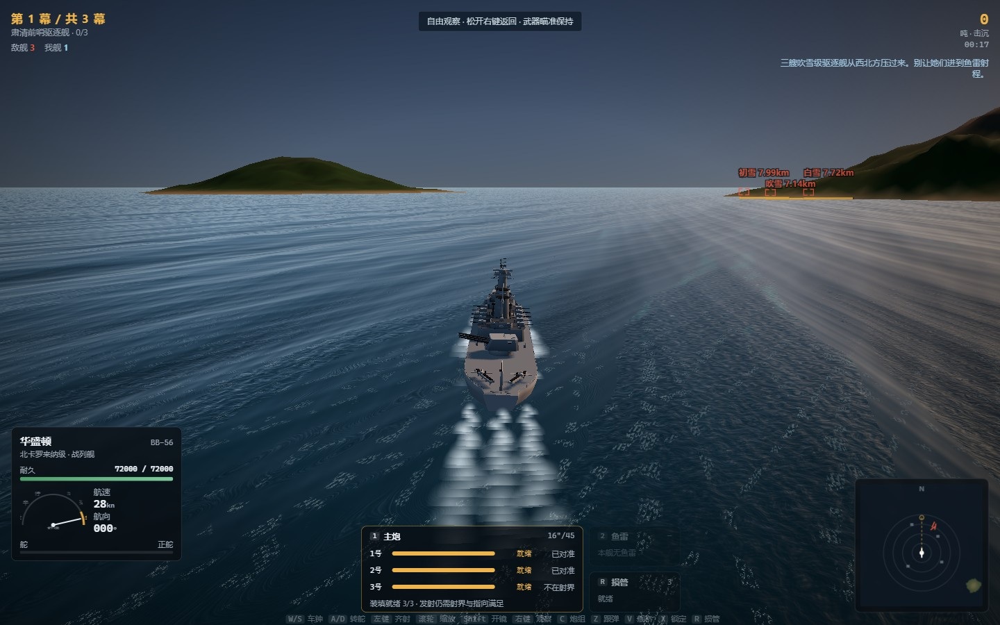
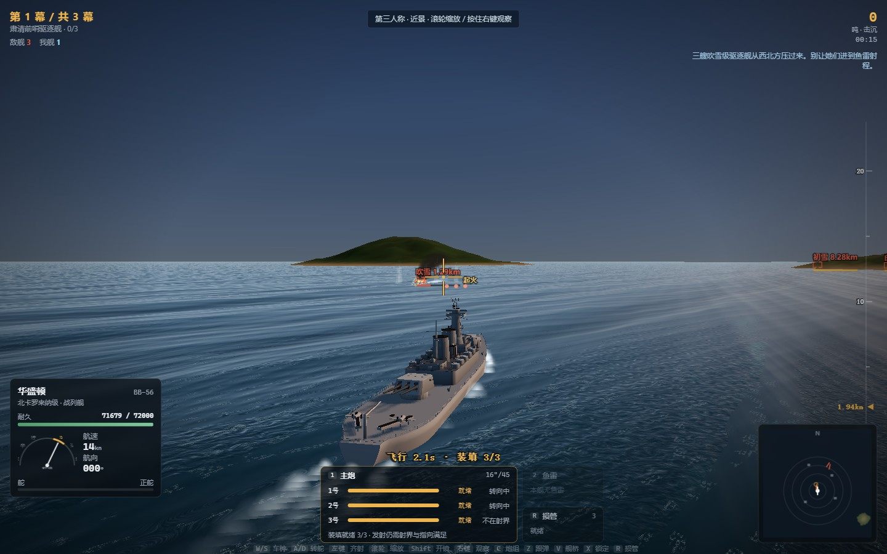

# 钢铁航线 1942 · 战舰炮战

一个跑在浏览器里的二战海战炮术游戏。参考 B 站《铁底湾 1942》的做法：纯逻辑的战斗模拟、
three.js 渲染、程序化生成的舰船模型，没有任何外部美术资源。

行动「钢铁航线」：你指挥美军战列舰华盛顿号，沿铁底湾向北打三幕——
**驱逐舰前哨 → 高雄级重巡拦截 → 金刚级战列舰**。两波脚本空袭会在中途进入，
幕间损管队抢修 25% 耐久。

## 画面





## 直接玩

<https://2409324124.github.io/warship-game/>

推送到 master 后由 `.github/workflows/deploy.yml` 自动构建并发布到 GitHub Pages，
打开链接就能玩，不需要任何本地环境。纯静态站点：没有后端，唯一的外部请求是
`./models/manifest.json`（舰船 GLB），音频全部由 WebAudio 现场合成。
构建用相对路径（`base: './'`），所以挂在任何子路径下都能跑。

## 本地跑

需要 Node 22.18+（`npm test` 直接用 `node --test` 跑 `.ts`）。

```bash
npm install
npm run dev        # http://127.0.0.1:5173
```

其他命令：

```bash
npm run typecheck  # TypeScript 严格模式检查
npm test           # 弹道、舰船配置、战役状态机与整场战斗的无头测试
npm run build      # 生产构建到 dist/
npm run smoke      # 无头 Edge 跑一遍行动并截图到 shots/（需先 npm run dev）
node tools/balance.ts   # 无头跑夜战基线与三幕行动，打印每幕时间和星级
```

## 操作

| 键 | 作用 |
|---|---|
| 鼠标 | FPS 式：左右转动火炮与视角（1:1，无惯性），上下调距离刻度 |
| 左键 | 主炮齐射 |
| Shift | 开镜（按一次常开，再按一次退出） |
| X | 锁定准星附近的敌舰（再按解除） |
| Tab | 切换锁定目标 |
| 右键 | 不绑定（浏览器右键冲突） |

| W / S | 车钟加减 |
| A / D | 转舵 |
| C | 切换第三人称跟随 / 舰桥第一人称 |
| R | 损管：灭火并抢修 |
| 1 / 2 | 主炮 / 鱼雷 |
| L | 提前量标记开关 |
| F3 | 弹道调试面板 |
| Esc | 暂停 |

副炮不需要操作：敌舰进入 5 km，十座 5 英寸炮会自己选目标、算提前量、开火。

## 目标锁定

按 `X` 锁定准星附近最近的敌舰，`Tab` 切换，再按 `X` 解除。锁定后：

- **火炮跟随**：主炮自动指向目标的**提前点**，她转向、变速时枪口跟着走；
- **微调归你**：鼠标输入变成叠加在自动解算上的**修正量**，不会被自动归零——
  距离修正是玩家的活儿，散布圈和水柱判定才是有意义的东西；
- **脱锁**：修正量超过 6° 或 12% 距离就自动解锁，所以它不是自瞄；
- **测距收敛**（战争雷霆强度）：刚锁定时额外散布是距离的 8%（10 km → 800 m），
  按 `e^(-t/2.2s)` 收敛到 0.6%，切换目标或脱锁后重置。这个误差直接送进 `fireShell` 的
  散布参数，所以"稳住锁定再开火"是有实际收益的；
- **提前量标记**：锁定目标上画实心菱形 + 十字，未收敛时半透明并标注"测距 xx%"。

## 炮术模型

弹道用三个互相咬合的量描述：**射程**、**弹道拱高比**（`arc = 顶点高度 / 射程`）、**初速**。
由它们反推出该炮的"虚拟重力"：

```
g = 8 · arc · v0² / range
```

于是飞行时间有个极其好用的恒等式：

```
T = 距离 / 初速
```

所以"10 km 落弹 11 秒"直接翻译为初速 `10000 / 11 = 909 m/s`。主炮就是这么定的
（`src/sim/guns.ts`），并有测试守着：`npm test` 里的 `10 km in 11.0 s`。

各炮的重力是独立的（30 ~ 88 m/s²），不是 9.81——这是为了让炮弹在空中停留得够久、看得见、
能修正。副炮掉得比主炮快，手感上就分开了。

**散布**：每门炮给出 1σ 散布，纵向（顺射向）大于横向（跨射向），随距离收紧但不会消失
（`ballistics.ts` 的 `sigmaAt`）。主炮 10 km 处纵向 90 m、横向 40 m。齐射时每发弹独立
按二维高斯散布落点，所以水柱天然撒成一个椭圆——也就是瞄准镜里那个圈。

**副炮自动射击**（`sim/gunnery.ts` 的 `secondaryLogic`）：每帧挑最近的敌舰，迭代三次求
提前量，炮塔转到射界内且装填完毕就各自开火，带自身误差；被岛屿挡住时压住不发。

## 建模

舰船没有外部资源，全部由代码生成（`src/render/shipModel.ts`）：

- 船体由站位放样：`sim/hull.ts` 给出每个站位的半剖面（舯部 U 形、`p=3.4`；艏部 V 形、
  `p=1.15`），相邻站位缝成蒙皮，再铺甲板；
- 上层建筑来自声明式部件表（方块 `Bx`、烟囱 `Cy`、桅 `Ms`、平台 `Pl`、鱼雷管 `Tt`、
  高炮 `Aa`、探照灯 `Sl`、测距仪 `Rf`、指挥仪 `Dr`、吊艇 `Bt`、弹射器 `Cp`、起重机 `Cr`、
  深弹架 `Dc`、炮塔 `Tu`），同一份数据同时喂给模拟的命中盒；
- 舷侧与甲板纹理用 canvas 现画（水线漆、舷号、木甲板/亚麻油毡）；
- 炮塔用 `LatheGeometry` 车出带锥度的炮管，可独立旋转与俯仰。

六艘舰：美军北卡级战列舰、日军金刚级战列舰、美军新奥尔良级重巡、日军高雄级重巡、
日军吹雪级驱逐舰、美军弗莱彻级驱逐舰。武器配置有数据测试守着
（3 座三联装 16 寸、10 座双联装 5 寸左右各五，等等）。

## 代码结构

```
src/
  sim/       纯逻辑，零 three.js 零 DOM，可在 Node 里跑（测试与平衡脚本就这么用）
    constants.ts   数学常量、时间压缩 (2.5×)、值噪声
    ballistics.ts  弹道求解、散布、命中概率
    guns.ts        炮/鱼雷/炮塔规格表
    hull.ts        船体线型（模拟与渲染共用）
    ships.ts       舰船规格与部件表
    ship.ts        单舰：运动、炮塔、伤害、起火、损管、沉没
    gunnery.ts     炮塔指向、射击、弹丸飞行、副炮自动射击
    torpedo.ts     鱼雷与拦截解算
    ai.ts          电脑舰长
    world.ts       世界步进、碰撞、玩家指令
    campaign.ts    关卡编排
    terrain.ts     岛屿高度场
  render/     three.js：引擎、天空、海面、地形、程序化建模、特效、瞄准标记
  ui/         HUD(overlay 画布 + DOM)、瞄准镜、海图
  audio/      WebAudio 程序化音效（无音频素材）
test/         弹道 / 舰船配置 / 整场战斗的无头测试
tools/        smoke.mjs（无头截图与像素探针）、balance.ts（平衡报表）
```

## 时间与距离

舰船运动做了 **2.5 倍时间压缩**（`TIME_COMPRESS`）。不压缩的话，36 节驱逐舰在 11 秒的
炮弹飞行时间里只走 190 m，提前量毫无意义；压缩后她走约 510 m，约 2.3 个舰身长——
提前量才成为一件需要判断的事。炮弹飞行时间则就是你要的那 11 秒，看得见、算得出、能修正。

## 已知取舍

- 装饰件（水上侦察机、浮筒、岛屿地标）按计划留到打磨阶段，可用 Blender 出 glTF 后接入
  `render/`；目前全部是程序化几何。
- 海面细节受网格密度限制：顶点只位移最长的一条涌浪，更短的波以逐像素法线叠加。
- 无头环境（SwiftShader 软件渲染）下帧率很低，实机 GPU 上正常。
